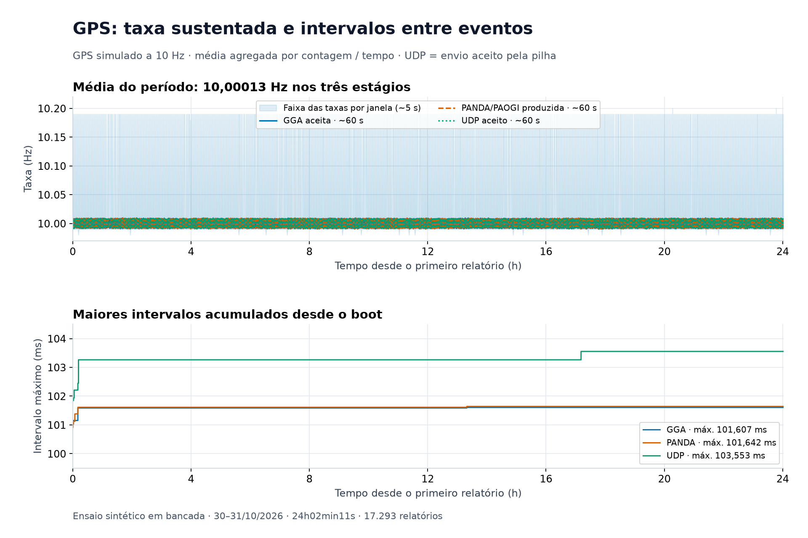
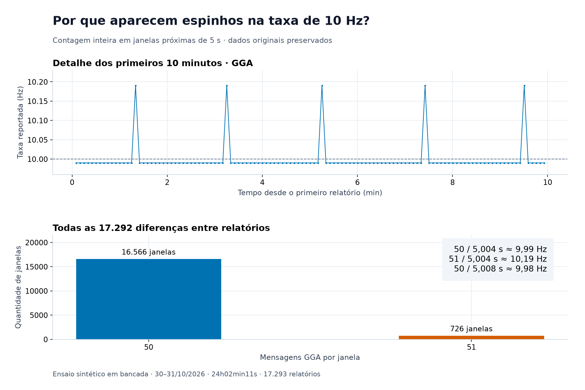
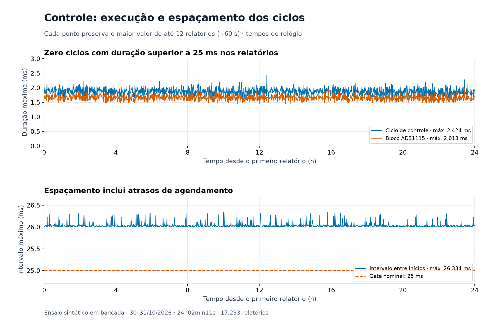
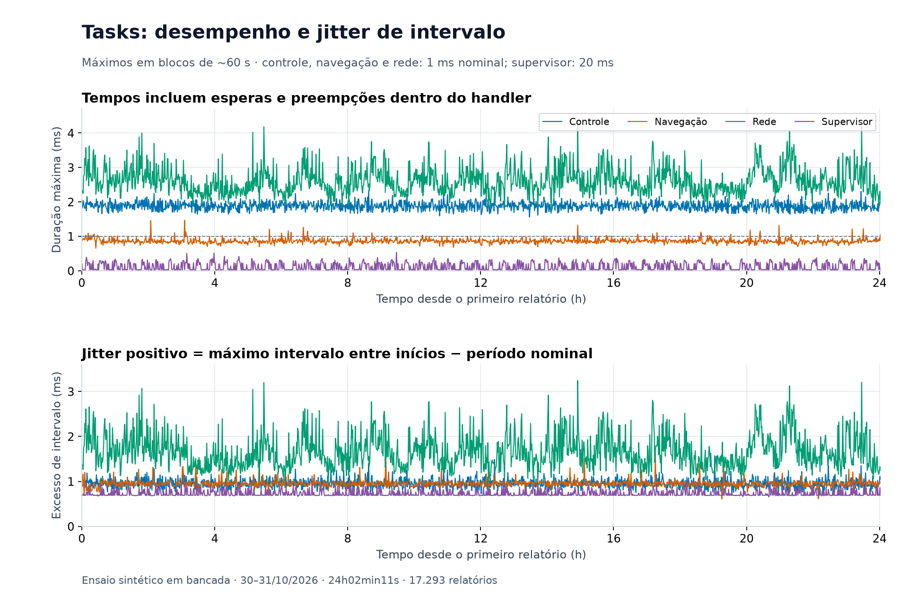
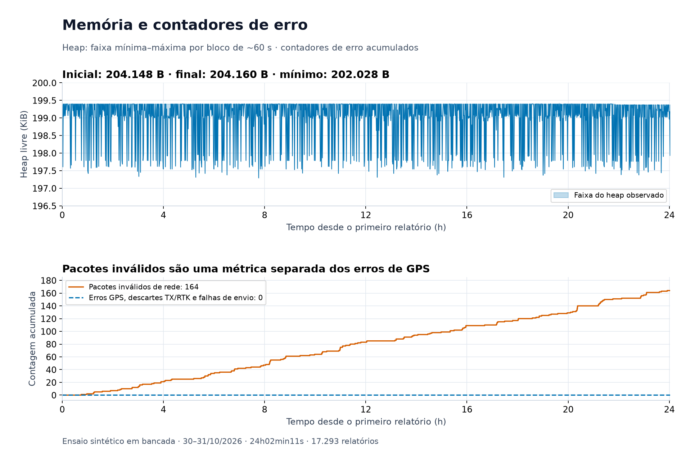

# Ensaio sintético de desempenho e estabilidade — 24 horas

O firmware manteve uma taxa média de **10,00013 Hz** para GGA aceita, PANDA/PAOGI produzida e envio GPS aceito pela pilha UDP ao longo de **24 h 02 min 11,485 s**. A captura contém **17.293 relatórios completos**, um único trecho de boot e nenhum reinício identificado no período observado. Os contadores de erros GPS, descartes TX/RTK e falhas de envio permaneceram zerados. Houve **164 pacotes classificados como inválidos na rede**, detalhados abaixo.

Os resultados documentam o comportamento nesta carga sintética de bancada. Não constituem medição de precisão de guiagem ou validação em campo.

## Condições do ensaio

| Item | Condição |
|---|---|
| Data | 30–31 de outubro de 2026 |
| Plataforma | Firmware AgOpenGPS para ESP32 WT32-ETH01 / Ethernet LAN8720 |
| Firmware ensaiado | `e50f4e4e4ab7e95e4caa59554021b8b0f8fffcab`, informado pelo responsável pelo ensaio |
| Ambiente | Teste sintético em bancada |
| Entrada GPS | Simulada, configurada para 10 Hz fixos |
| BNO085, motor e RTK | Ativos, conforme relato do responsável pelo ensaio |
| HPR | Ativo no início e desativado intencionalmente durante o ensaio |
| Estado amostrado | `available=1`, `engaged=1`, `guidance=1`, `mode=none`, velocidade de comando de 8,0 km/h em todos os relatórios |
| PWM amostrado | Valores entre 0 e 60; engajamento lógico não implica PWM diferente de zero |
| Diagnóstico | Blocos seriais com `DIAG`, `TASK`, `CYCLE`, `ADS`, `MOTOR`, `GPS`, `CONTROL` e `STEER` |
| Intervalo dos relatórios | De 5.002 a 5.009 ms |

A velocidade de 8,0 km/h é um comando recebido pelo firmware durante o teste parado, não uma medição de deslocamento. O log não identifica a taxa de pacotes RVC nem o volume RTK, a carga mecânica do motor ou a alimentação elétrica; a participação desses componentes é registrada conforme o relato do ensaio.

O último avanço do contador HPR aparece a **00:32:41,596** desde o primeiro relatório, com resolução temporal de aproximadamente 5 s. O responsável confirmou que desativou HPR: o contador estável daí em diante corresponde a essa alteração deliberada. A captura cobre GGA/PANDA/UDP durante as 24 horas, com HPR ativo apenas na parte inicial; não representa 24 horas de processamento contínuo de HPR.

## GPS: taxa, contadores e intervalos



No painel superior, cada média resulta da soma das diferenças dos contadores dividida pelo tempo coberto por 12 janelas consecutivas, aproximadamente 60 s. A área azul clara preserva o mínimo e o máximo das taxas reportadas nas janelas originais de aproximadamente 5 s. As curvas dos três estágios se sobrepõem porque os resultados são muito próximos.

| Estágio | Contador inicial | Contador final | Incremento observado | Taxa média do período |
|---|---:|---:|---:|---:|
| GGA aceita | 334 | 865.660 | 865.326 | 10,00012885 Hz |
| PANDA/PAOGI produzida | 334 | 865.660 | 865.326 | 10,00012885 Hz |
| GPS inserido na fila | 334 | 865.660 | 865.326 | 10,00012885 Hz |
| GPS com envio UDP aceito | 334 | 865.660 | 865.326 | 10,00012885 Hz |

O incremento exclui mensagens anteriores ao primeiro relatório. `UDP aceito` significa que a pilha local aceitou o envio; não confirma entrega ou processamento no computador com AgIO/AgOpenGPS. Os contadores também não identificam épocas GNSS distintas ou duplicadas.

| Maior intervalo entre eventos | Valor registrado |
|---|---:|
| GGA aceita | 101,607 ms |
| PANDA/PAOGI produzida | 101,642 ms |
| Envio GPS aceito pela pilha UDP | 103,553 ms |

Esses três máximos são **acumulados desde o boot**. Uma linha horizontal no painel inferior significa que nenhum novo recorde foi registrado, não que todos os intervalos tiveram exatamente aquele valor. Podem incluir eventos anteriores ao início desta captura.

### Por que aparecem espinhos para cima e para baixo?



A taxa usa a diferença de um contador inteiro dividida pela duração da janela. Quando as bordas da janela se deslocam em relação aos eventos de 100 ms, a contagem alterna entre 50 e 51 mensagens:

| Exemplo de janela | Cálculo | Taxa exibida |
|---|---|---:|
| 50 mensagens em 5,004 s | `50 / 5.004` | 9,99 Hz |
| 51 mensagens em 5,004 s | `51 / 5.004` | 10,19 Hz |
| 50 mensagens em 5,008 s | `50 / 5.008` | 9,98 Hz |

Das **17.292 diferenças entre relatórios**, **16.566** contêm 50 GGA e **726** contêm 51 GGA. PANDA e TX têm a mesma distribuição de contagens. As taxas reportadas ficam entre **9,98 e 10,20 Hz**, enquanto a média do período fica em **10,00013 Hz**.

Neste ensaio, os espinhos são compatíveis com a contagem discreta e as bordas das janelas. A escala vertical estreita aumenta seu destaque visual. A interpretação é sustentada pelos contadores, pelos maiores intervalos registrados e pela ausência de erros GPS registrados; não depende apenas da aparência do gráfico. O desvio residual da média em relação a 10 Hz também depende da resolução temporal e das bordas da captura, não sendo uma calibração do relógio do simulador.

O tratamento visual adotado é agregar por aproximadamente 60 s e preservar os extremos originais. Nenhum espinho é apagado ou substituído. Essa explicação se aplica à taxa em Hz desta captura; picos de duração, atraso ou erro exigem interpretação própria.

## Controle e ADS1115



| Métrica | Resultado |
|---|---:|
| Maior duração `CYCLE peak` nas janelas capturadas | 2,424 ms |
| Maior duração do bloco ADS1115 | 2,013 ms |
| Maior intervalo entre inícios dos ciclos | 26,334 ms |
| Maior excesso sobre o gate de 25 ms, em ticks inteiros | 1 ms |
| Ciclos com duração superior a 25 ms (`over25ms`) | 0 |
| Ciclos com intervalo superior ao gate (`late`), somados nos relatórios | 20.697 |

**Duração de execução e espaçamento entre ciclos são métricas diferentes.** Zero execuções acima de 25 ms não significa que todos os ciclos começaram exatamente a cada 25 ms. O maior intervalo observado foi 26,334 ms. O campo `lateMax` tem resolução de 1 ms e não mede a fração adicional de microssegundos.

O campo legado `CONTROL peak` já era **2,794 ms** no primeiro relatório e permaneceu nesse valor. Ele é acumulado desde a inicialização, enquanto `CYCLE peak` é retirado e zerado a cada janela. Portanto, o máximo acumulado anterior à captura não deve ser confundido com o máximo de 2,424 ms medido nas janelas mostradas.

## Desempenho e jitter das tasks



| Task | Período nominal | Faixa de Hz reportada | Maior execução | Maior intervalo entre inícios | Jitter positivo máximo de intervalo | Maior atraso de início (`lateMax`) | Menor stack livre registrado |
|---|---:|---:|---:|---:|---:|---:|---:|
| Controle | 1 ms | 999–1.000 Hz | 2,431 ms | 2,571 ms | 1,571 ms | 2 ms | 2.572 bytes |
| Navegação | 1 ms | 999–1.000 Hz | 1,464 ms | 2,639 ms | 1,639 ms | 1 ms | 2.044 bytes |
| Rede | 1 ms | 999–1.000 Hz | 4,220 ms | 4,244 ms | 3,244 ms | 4 ms | 2.108 bytes |
| Supervisor | 20 ms | 49–50 Hz | 0,530 ms | 21,122 ms | 1,122 ms | 1 ms | 1.356 bytes |

Aqui, **jitter positivo de intervalo = `max(0, gapMax − período nominal)`**. Essa definição mostra o maior alongamento do intervalo entre duas passagens consecutivas. Ela difere de `lateMax`, que compara o início com o tick programado pelo agendador. Não é jitter RMS, desvio-padrão ou uma distribuição dos tempos de cada passagem.

As taxas `TASK Hz` são médias por janela truncadas para inteiro pelo firmware. Assim, 999 Hz ou 49 Hz não demonstram, por si só, uma perda equivalente de ativações. Os intervalos e atrasos complementam essa média. Execução mede tempo de relógio dentro do handler, incluindo esperas e preempções; não é utilização exclusiva de CPU.

| Task | Inícios atrasados (`late`), soma das janelas | Execuções acima do período nominal (`over`), soma das janelas |
|---|---:|---:|
| Controle | 3.457.855 | 3.460.632 |
| Navegação | 387 | 58 |
| Rede | 57.890 | 374.432 |
| Supervisor | 152 | 0 |

Os números mostram que o passo nominal de 1 ms não é cumprido uniformemente. Na task de controle, o handler inclui o ciclo efetivo e o acesso ao ADS1115 a cada gate de 25 ms; exceder 1 ms nesse handler não equivale a exceder 25 ms na execução do ciclo de direção. Os contadores não identificam sozinhos a origem de cada atraso.

Os gráficos de execução e jitter preservam o **máximo** de cada bloco de aproximadamente 60 s, sem suavizar os picos. Os valores de stack são mínimos históricos de espaço livre, não consumo instantâneo. O log não permite reconstruir o histograma de jitter de todas as ativações, percentis por passagem ou carga exata de CPU.

## Memória, erros e descartes



| Métrica | Resultado |
|---|---:|
| Heap livre inicial | 204.148 bytes |
| Heap livre final | 204.160 bytes |
| Menor heap observado nos relatórios | 202.028 bytes |
| Maior heap observado nos relatórios | 204.208 bytes |
| Diferença final − inicial | +12 bytes |
| Erros NMEA / CRC | 0 / 0 |
| Overflow UART / buffer RX cheio | 0 / 0 |
| Erros de enquadramento / paridade | 0 / 0 |
| Falhas de montagem / envio GPS | 0 / 0 |
| Descartes na fila TX / FIFO RTK | 0 / 0 |
| Falhas gerais de envio | 0 |
| Pacotes classificados como inválidos na rede | 164 |

O heap retorna a valores próximos do inicial e termina 12 bytes acima dele. Isso não evidencia uma queda sustentada nesta captura. A amostragem de aproximadamente 5 s não mede o mínimo entre relatórios nem demonstra ausência de fragmentação ou de todo vazamento possível.

O contador `net.invalid` é separado dos erros de GPS. No código do firmware ensaiado, pode ser incrementado por validação de PGN, leitura de datagrama com tamanho divergente ou certas falhas de decodificação/aceitação. O diagnóstico não registra payload, motivo individual ou origem desses 164 eventos; não é possível atribuí-los a uma causa específica a partir deste JSON. Eles são mantidos no relatório e não classificados como cosméticos.

Zero descartes RTK é o valor observado do contador, não uma medição de volume ou garantia de utilização das correções pelo receptor. Da mesma forma, zero erros UART registrados não prova ausência absoluta de perda, pois a coleta de eventos também tem limites.

## Método, rastreabilidade e reprodução

Os cálculos usam `uptimeMs` do firmware, de **35.031 ms** a **86.566.516 ms**, resultando em **86.531.485 ms** entre o primeiro e o último relatório. O tempo de recepção do computador é preservado nos metadados, mas não substitui o relógio usado para calcular as taxas. Em UTC, os horários de recepção vão de `2026-10-30T16:39:30.982Z` a `2026-10-31T16:41:16.726Z`; o intervalo do relógio do PC difere do uptime em aproximadamente 25,7 s.

Foram verificados: relatórios completos e sem tempo estimado, um único boot, uptime estritamente crescente, contadores acumulados monotônicos e igualdade entre cada diferença de uptime e a respectiva janela `DIAG`. Não foram encontradas janelas inteiras ausentes nessa sequência.

- As taxas agregadas usam diferenças de contadores e a soma dos tempos; não a média simples de valores de Hz já arredondados.
- A primeira amostra é a base das diferenças. Sua própria janela não entra nas taxas nem no CSV agregado, pois precede o primeiro instante observado.
- São **1.441 blocos de 12 janelas**, sem sobreposição. Os gráficos de tempos preservam máximos e o de heap preserva mínimos/máximos nesses blocos. Os máximos e as somas das tabelas consideram todos os relatórios, inclusive a janela do primeiro relatório.
- Os máximos GPS e o mínimo histórico de stack são acumulados desde o boot; os acumuladores `TASK`, `CYCLE`, `ADS` e `MOTOR` são por janela. As coletas entre módulos são sequenciais, não um snapshot atômico de todo o sistema.

### Arquivos

| Arquivo | Conteúdo |
|---|---|
| [summary.json](summary.json) | Estatísticas, contadores, metadados e SHA-256 da fonte |
| [minute-summary.csv](minute-summary.csv) | Agregados de aproximadamente 60 s com limites de tempo, taxas, extremos e contagens |
| [tools/plot_stability.py](../../../tools/plot_stability.py) | Script que reproduz estas cinco figuras e os agregados a partir do JSON original |
| [tools/requirements-performance.txt](../../../tools/requirements-performance.txt) | Versões das dependências usadas |

Fonte: `Servidor · Serial COM7 - 2026-10-30T13_39_00 · ao vivo.json`, esquema `ploty-wt32-v1`, **91.674.979 bytes**. O JSON bruto é mantido separadamente; os arquivos deste diretório contêm os gráficos e dados derivados.

SHA-256 do JSON original:

```text
fbf411cede67958eed348d72cef6e16044c1f085f05724574834b73310bfb293
```

Reprodução a partir da raiz do repositório, com Python 3.12 ou superior (usado: 3.12.14):

```sh
python3 -m venv /tmp/aog-performance-venv
/tmp/aog-performance-venv/bin/python -m pip install -r tools/requirements-performance.txt
/tmp/aog-performance-venv/bin/python tools/plot_stability.py "/caminho/para/sessao.json" \
    --output docs/performance/2026-10-30
```

O script verifica o hash da fonte porque suas legendas descrevem este ensaio específico. Para outro ensaio, os dados e as legendas devem ser revistos juntos. A definição dos campos está em [Arquitetura — diagnóstico de temporização](../../ARCHITECTURE.md#diagnóstico-de-temporização); a instrumentação está em [src/tasks.cpp](../../../src/tasks.cpp).

## Alcance dos resultados

A captura dá evidência de operação prolongada do firmware sob esta carga sintética, com taxa GPS sustentada, contadores internos sem descartes TX/RTK registrados e heap final próximo do inicial. Também documenta os atrasos de agendamento e os pacotes inválidos observados.

O ensaio não mede recepção efetiva no PC, precisão GNSS real, desempenho de guiagem, reação a todas as falhas, interferência elétrica, temperatura ou carga mecânica de campo. O diagnóstico estava ativo e acrescenta custo de instrumentação. A confirmação de BNO085, motor e RTK ativos descreve a montagem; estes relatórios não medem integralmente o desempenho de cada periférico. HPR foi desativado durante o teste por decisão do responsável.
